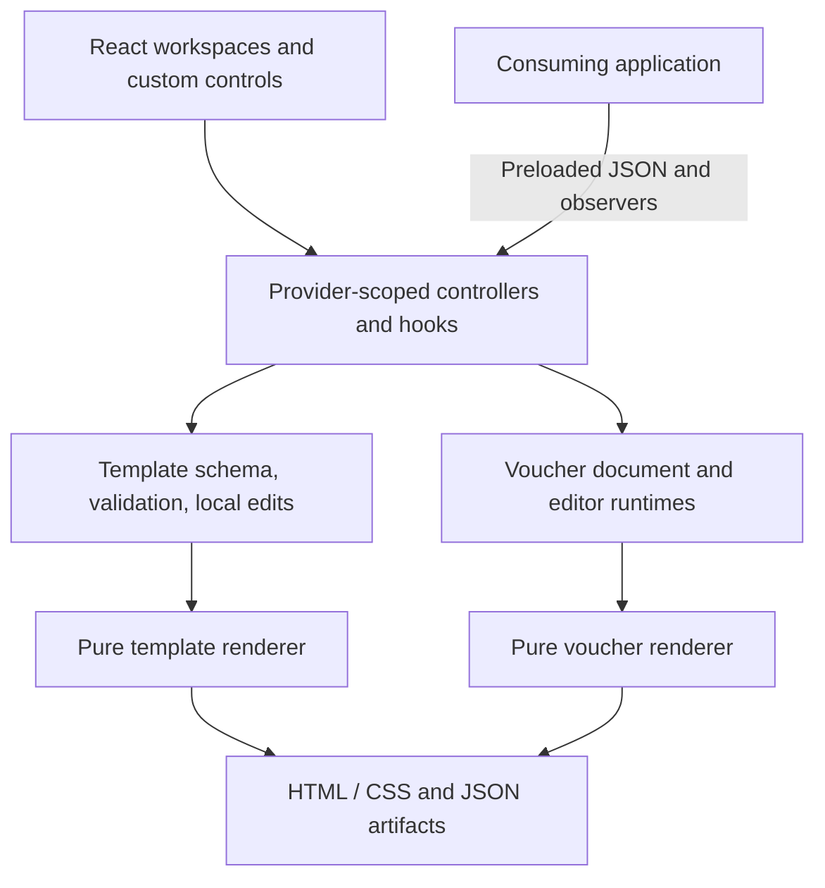

# Architecture and maintenance

## Runtime boundaries

| Directory / entry | Responsibility |
|---|---|
| `src/template-core/schema.ts` | Canonical wire contracts/types and JSON Schema generation. |
| `contracts.ts` / `validation.ts` | Runtime data/defaults, semantic references, editing permissions and snapshot/input parsing. |
| `render.ts` / `styles.ts` | Pure HTML/CSS compilation and supported style/URL policy. |
| `editing.ts` | Local template document controls, selection, history, synchronous outputs and observer isolation. |
| `src/template-creator/` | Creator/editor React surfaces, scoped hooks, typed controls, canvas, demo, workspace CSS. |
| `src/voucher-builder/engine/` | Voucher graph/document operations and structural commands. |
| `store/` / `instance.ts` / `provider.tsx` | Document vs transient state, transactions, per-instance operations and React integration. |
| `blocks/` / `builder/settings/` | Registered voucher types, traits/scopes, renderers, settings UI. |
| `export/` / `templates/` | Pure voucher HTML/JSON import/render and in-memory template choices. |
| `src/*.ts` entry modules | Explicit public package boundaries. |
| `schemas/` | Generated portable wire schemas. |
| `examples/` / `docs/` | Executable/typed examples, behavior guides, generated public inventory. |
| `scripts/` | Schema/docs/package/example validation and version-matched UI skill/composition checks. |

Template renderer/schema and voucher renderer/schema/manifest/headless entries must remain usable without React/DOM imports. React providers are browser integration boundaries. Factories retain stores in private WeakMaps; expose stable commands/snapshots rather than stores. JSON parsing/cloning is intentional at trust and callback boundaries. Structural sharing reuses unchanged template subtrees for focused subscriptions.

A supplied controller belongs to its host. Providers restore observer configuration on unmount; owned document controls disconnect observers. Rendering and HTML/JSON exports are synchronous local work. The host loads input and handles output independently. Do not add application sessions, request clients, persistence, publication or PDF service workflows.

## Extending the model

For template wire changes, edit `schema.ts`, types inferred from it, semantic validation, rendering, relevant controls, and fixtures together. Decide whether a change requires a new schemaVersion and migration; do not quietly reinterpret an existing persisted format. Regenerate schemas from the runtime validators rather than maintaining independent copies. Field vocabulary deliberately stays portable and excludes executable validation expressions.

For a voucher block type, update its Zod schema/union, definition, renderer, export case, and definition registration. Reuse the existing traits/scopes/settings primitives. Block/trait/scope modules register side effects on import; preserve those imports and package sideEffects metadata. Do not deep-import internal stores from consuming applications.

For public APIs, update the appropriate `src/*.ts` entry and behavior guide, regenerate the export inventory, add a consumer example when appropriate, and run package smoke checks. Keep deprecated methods labelled with replacement guidance. Reversible visual-only edits do not need implementation-mirroring tests; state/contract/interaction fixes need focused regressions.

## Development

Use Node.js 24 and npm with the checked-in lockfile. `npm install` runs the package's prepare build; `npm ci` is suitable for clean reproducible installations. In restricted environments Node may need permission to resolve the project path. Resolve environment permissions rather than changing project code to work around filesystem access errors.

| Command | Purpose / prerequisite |
|---|---|
| `npm run dev` | Vite demo on port 3000. |
| `npm run setup:ui` | Copy the complete official Themelia bundle into package-local `.agents/skills` and `.claude/skills`; archive differing/obsolete managed skills outside discovery. Repeated runs are supported. |
| `npm run check:ui-skill` | Verify installed package identity, four skills and 64 rebased assets per destination, templates, and contributor instructions. |
| `npm run test:ui-skills` | Run isolated setup regressions for both destinations, stale/missing assets, repeat runs, backup preservation and unsafe paths. |
| `npm run check:ui` / `npm run lint` | Run Themelia composition policy and adapter/CSS checks on reachable UI; inspect dynamic and visual states in the browser too. |
| `npm run check:ui-audit` | Check reviewed UI/source/contract/package fingerprints; renew manual decisions after changes. See [UI compliance](UI_COMPLIANCE.md). |
| `npm run check:frontend` | Reject network/storage APIs and removed service-lifecycle members in the reachable component runtime. |
| `npm run typecheck` | Source and test TypeScript checks, independent of dist. Built consumer examples have their own check. |
| `npm test` | Regression suite; default maximum two concurrent workers to avoid DOM-test contention. |
| `npm run build` | Production browser demo into dist. |
| `npm run preview` | Serve the last app build. |
| `npm run build:lib` | ESM package JavaScript/CSS into dist. |
| `npm run build:browser` | Standalone browser PostCSS runtime, source map and dependency licenses into dist-browser; does not erase dist. Also runs before normal dev/demo build commands. |
| `npm run build:types` | Type declarations and rewritten path aliases. |
| `npm run build:schemas` | Generate all six wire schemas from the built template-schema entry. |
| `npm run build:package` | Sequential library → browser CSS runtime → declarations → schema build. |
| `npm run build:composer` | Generate publishable source, optional Laravel integrations, metadata and a bundled server renderer in the Composer library. |
| `npm run check:composer` | Reject missing, modified or obsolete generated Composer resources without repairing them. |
| `npm run test:composer` | Qualify generated resource checksums/drift, published-source types, isolated browser/Tailwind, bundled-worker, headless and SSR behavior. Native PHP installation/service qualification belongs to the package PHP suite. |
| `npm run check:schemas` | Check generated schema drift against the built library. |
| `npm run build:docs` | Generate export inventory and event payload reference from source. |
| `npm run check:docs` | Inventory drift, local links/anchors, command and event coverage. Build declarations first. |
| `npm run build:examples` | Regenerate deterministic wire fixtures from the built package. |
| `npm run check:examples` | Compile React consumer examples; execute composition and verify wire fixtures. Build package first. |
| `npm run check:package` | All runtime export imports and assets/declarations/docs presence; `scripts/check-rendering.mjs` verifies isolated non-UI rendering with React blocked and network/storage I/O rejected; self-contained wire schema checks. |
| `npm run check:browser` | Copy the actual distribution into an isolated fixture, optimize all ten entries with Vite, evaluate the client graph and require zero externalized-property warnings. Compare CSS/document/email output against Node; verify malformed CSS feedback, browser parsing without Node globals and original Node/SSR dependency resolution. |
| `npm run verify` | Complete sequential skill/composition/source/test/app/package/docs/example/package checks. Ends with distributable package output. |

The app and package both write dist. Do not run either build concurrently with the other or with tests relying on dist. `npm run build:schemas` imports the built entry; rebuild the library before using it after schema source changes. The same applies to composition fixtures.

The current UI baseline is Themelia 2.0.4 with official Base UI ^1.9.0. After an upgrade, read the installed README/changelog, refresh both skill bundles with `setup:ui`, and run `check:ui-skill` plus `test:ui-skills`. The canonical skills are components, tokenization and composition; their shared consumer folder owns references, scripts, examples and templates. Keep product rules outside these copied assets. Previous managed bundles live under `.cache/themelia-skills-backups`, outside agent discovery.

`scripts/build-browser.mjs` resolves PostCSS through Node before bundling, so its own output cannot become the next build's input through the browser mapping. Keep the generated browser runtime outside dist: the demo build empties that directory. Rebuild the browser asset whenever its locked dependencies change; the build emits their original license texts. Keep the Node dependency external in the main library build.

A browser-only package update still changes an archive hash. Hosts that use that hash as a backend compiler identity must verify every existing Node runtime file, Node export/dependency resolution, locked dependency versions, worker bytes and Node binary before intentionally retaining a supported explicit backend build identity. Any change to the actual backend compiler requires a new build identity. Never rewrite stored revision checksums or bypass a compatibility failure to install an update.

## Verification and release

Vitest uses two workers to keep DOM-heavy Themelia workspace suites from competing for host CPU. Preserve the normal test timeouts and assertions; diagnose a slow suite in isolation before changing either.

1. Run `npm run typecheck` and targeted regressions while editing; run the complete suite after meaningful changes settle.
2. Run `npm run build`, open a local production preview, verify the affected flows/console and desktop/narrow embedding. Close temporary tabs and stop servers when done.
3. Run `npm run build:package` after the app checks so dist ends with library output.
4. If public exports, wire contracts, or fixtures changed, run `npm run build:docs` / `npm run build:examples` and review the generated diff.
5. Run `npm run check:schemas`, `npm run check:docs`, `npm run check:examples`, `npm run check:package`, and `npm run check:browser`.
6. Inspect `npm pack --dry-run --ignore-scripts` for expected files, exports, docs, schemas, and absence of temporary/private files. Commit required generated updates and changelog/migration guidance before tagging/publishing.

`npm run verify` performs the automated sequence. It does not publish, tag, deploy, run production API requests, or replace manual browser checks. A valid package must retain all chunks referenced by its entry files; copying only dist/index.js is insufficient.

## Troubleshooting

| Symptom | Check |
|---|---|
| Consumer reports missing dist or exports | Run build:package; check install scripts were allowed and ESM/bundler module resolution is configured. |
| Editor styles are absent | Import the package stylesheet once; check host base styles and import order. |
| Non-UI bundle pulls React | Use /template-renderer, /template-schema, /renderer, /headless, /schema, or /manifest rather than UI/root/hooks entries. |
| Data contract rejects an apparently valid payload | Check field ID vs path, numeric strings vs numbers, extra properties, required nested parents, explicit null, and revision identity. |
| Read-only values reject on restoration | Supply application-owned initialData/trustedData and compatible runtime defaults; conflicting supplied values reject. |
| Values do not update after changing initial props | Initial values are read once. Use document load commands or remount deliberately. |
| No JSON Schema update after source change | Rebuild the library before build:schemas; generators read dist. |
| Template checks block HTML export | Resolve semantic issues and local invalid drafts; design samples do not substitute missing runtime values in personalization. |
| HMR reports an unknown controller instance | Factory WeakMaps may have been replaced by a module reload. Reload the development page; do not persist controllers across full runtime-module replacement. |
| UI test times out only under full suite | Check worker/resource contention before changing assertions; bounded workers are configured. |
| Printed HTML differs from canvas | Check the host's fonts/assets, resource readiness, page CSS and print settings. |

The package consists of frontend composition components, local hooks/commands, portable contracts and pure renderers. Arbitrary HTML/Blade round-trip and automatic personalization migration are outside its supported document model. Known boundaries are documented in [contracts](CONTRACTS.md) and [host composition](INTEGRATION.md).
